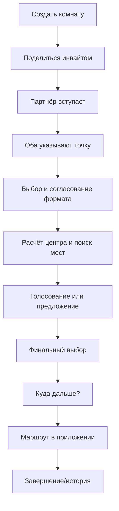
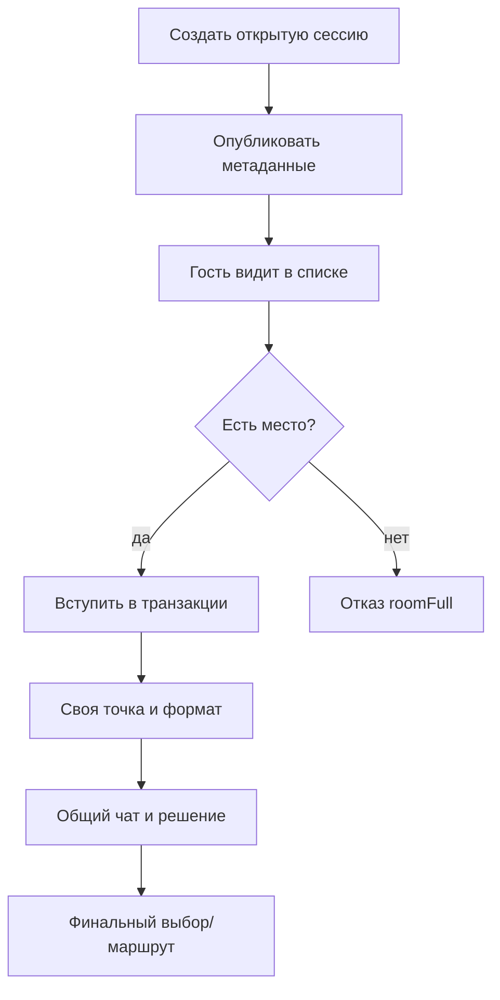
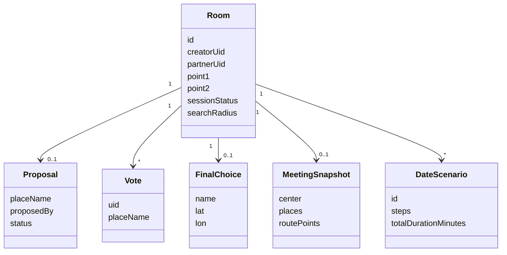
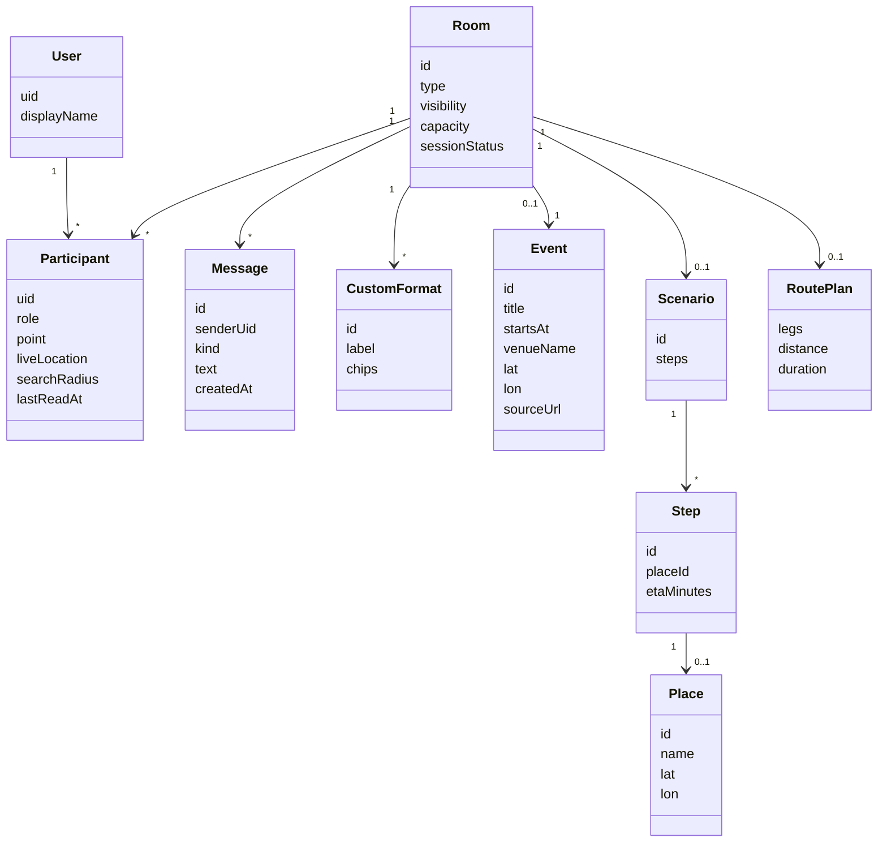
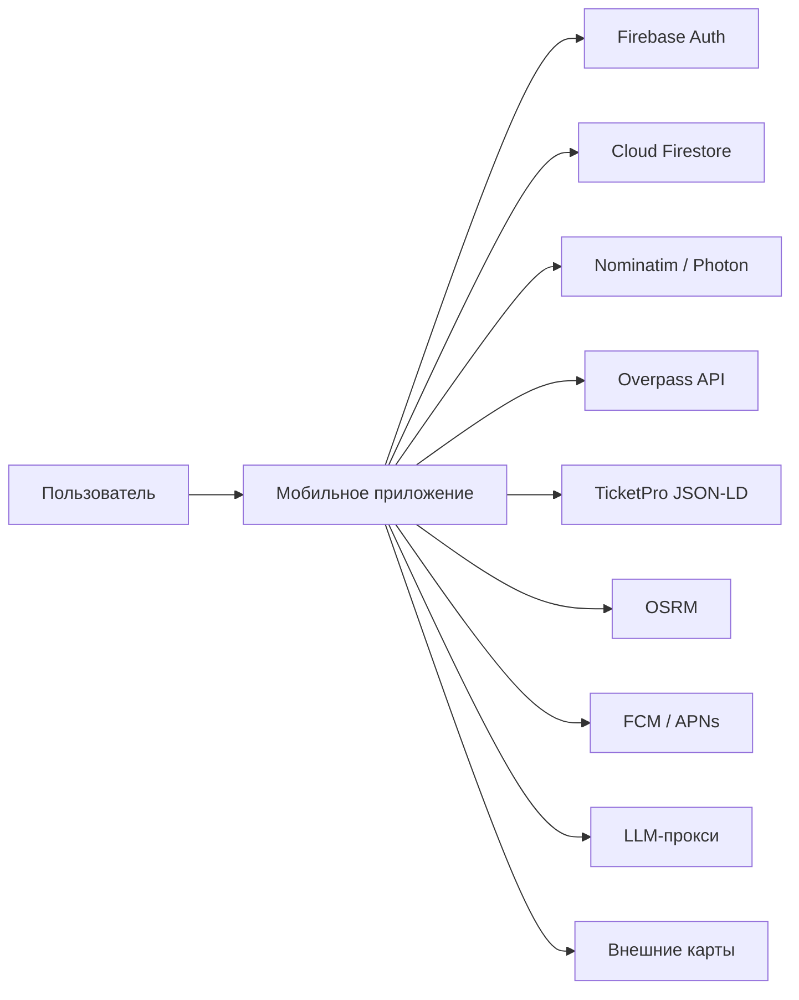

# Анализ предметной области

Документ фиксирует, **что именно** моделирует приложение, какие у домена
акторы, правила, процессы и ограничения. Технический выбор стека и сравнение
аналогов — в `02_analysis.md`; здесь фокус на предметной области.

## 1. Границы анализа
В область входит процесс совместного планирования встречи:
- от появления намерения встретиться до согласованного места, маршрута и
  следующего шага;
- приватные комнаты на двоих и открытые сессии для нескольких участников;
- коммуникация внутри комнаты и уведомления;
- подбор мест, форматы, голосование, маршрут;
- AI-консьерж как советник, а не автономный участник.

Не входят: бронирование, платежи, видеозвонки, общественный транспорт,
промышленная модерация, социальный граф, собственная картография.

## 2. Описание предметной области
Встреча — это согласование **кто, где, когда и что делает**. В приложении
«когда» остаётся вне ядра (комната живёт ограниченное время), а основная
ценность — согласовать **место и формат** с учётом точек участников.

Домен можно описать как пространственно-временную задачу группового выбора:
1. У каждого участника есть точка (координата) и предпочтения (формат).
2. Нужно найти область/точку, удобную относительно точек участников.
3. В этой области найти места, подходящие по формату и качеству.
4. Согласовать одно место (голосование/предложение/финальный выбор).
5. При необходимости продолжить встречу следующим шагом и построить маршрут.
6. Поддерживать коммуникацию и состояние в реальном времени.

Событие — частный случай встречи: у него есть фиксированная площадка, время
и внешний источник (TicketPro). В домене это отдельная сущность `Event`,
привязанная к комнате; она даёт контекст «идём вместе на концерт/спектакль»,
но не заменяет механику выбора места для обычной встречи.

Ключевая особенность текущей реализации: «равноудалённая точка» — это не
геометрический центр и не изохрона, а точка на маршруте между двумя точками,
выбранная по половине **времени в пути** (`osrm_remote_data_source.dart:65`,
`_findPointByHalfDuration`). Это важное доменное допущение: оно зависит от
профиля маршрута (сейчас driving) и не гарантирует равенство времени для
произвольного числа участников. В v2 для открытых сессий потребуется более
общая модель (центроид/медиана/изохроны) — это ограничение фиксируется.

## 3. Акторы и стейкхолдеры
| Актор | Роль в домене | Интерес |
|---|---|---|
| Инициатор (хост) | Создаёт комнату, приглашает, может завершить | Быстро согласовать встречу |
| Партнёр | Второй участник приватной комнаты | Удобное место, понятный сценарий |
| Гость открытой сессии | Находит и вступает в публичную сессию | Компания, прозрачные правила |
| Владелец аккаунта | Избранное, история, адреса | Повторяемость, удобство |
| Модератор (перспектива) | Жалобы, ограничения | Безопасность |
| Внешние сервисы | Геокодинг, места, маршруты, push, LLM | — |
| Платформа (iOS/Android) | Разрешения, уведомления, фон | — |
| Разработчик/исследователь | Аналитика, замеры | Качество и доказательства |

## 4. Глоссарий
| Термин | Определение |
|---|---|
| Комната (room) | Общее состояние встречи, синхронизируемое между участниками |
| Приватная сессия | Комната по инвайту, ровно 2 участника |
| Открытая сессия | Публичная/обнаруживаемая комната с capacity N |
| Хост | Создатель комнаты |
| Участник | Пользователь, вступивший в комнату |
| Точка | Координата участника (GPS или адрес) |
| Формат | Тип встречи: food/culture/walk/active + кастомные |
| Чип | Подтип/фильтр внутри формата (кафе, музей, парк…) |
| Центр | Вычисленная точка для поиска мест |
| Радиус | Ограничение области поиска, 200–3000 м |
| Место (place) | POI из OSM/Overpass/Nominatim |
| Предложение | Альтернативное место от участника |
| Голос | Выбор места участником |
| Финальный выбор | Зафиксированное место встречи |
| Сценарий | Последовательность шагов встречи |
| Следующий шаг | Место/активность после финального выбора |
| Событие | Концерт/спектакль/выставка с датой, площадкой и ссылкой |
| Live-локация | Текущая позиция участника на время sharing |
| Маршрут | Геометрия, расстояние и ETA между точками |
| Инвайт | Код/ссылка для входа в приватную комнату |
| Capacity | Максимум участников открытой сессии |
| Discovery | Список открытых сессий |
| Unread | Число непрочитанных сообщений |

## 5. Процессы «как есть» и «как должно быть»

### 5.1. Приватная встреча (as-is)
```text
Переписка в мессенджере
  -> ручной обмен адресами
  -> поиск места в картах
  -> сравнение расстояний вручную
  -> согласование в чате
  -> внешняя навигация
```
Проблемы: адреса теряются, расстояния считаются вручную, нет общего состояния,
нет истории решения, нет следующего шага.

### 5.2. Приватная встреча (to-be)


### 5.3. Открытая сессия (to-be)


### 5.4. Решение о месте
1. Оба участника задали точки.
2. Форматы пересеклись/подтверждены.
3. Система строит центр и ищет места в радиусе.
4. Участники голосуют или предлагают альтернативу.
5. Принятое предложение/голос фиксирует финальный выбор.
6. После фиксации — следующий шаг и маршрут.

## 6. Варианты использования (ключевые)
| ID | Use case | Актор | Предусловие | Результат | Исключения |
|---|---|---|---|---|---|
| UC-01 | Создать приватную комнату | Хост | Вход выполнен | Комната + инвайт | Ошибка сети |
| UC-02 | Вступить по инвайту | Партнёр | Валидный инвайт | Участник в комнате | Истёк/занято |
| UC-03 | Задать точку | Участник | В комнате | Координата сохранена | Нет разрешения/адрес не найден |
| UC-04 | Согласовать формат | Участники | Оба в комнате | Общий формат | Нет пересечения |
| UC-05 | Найти места | Участники | Точки + формат | Список мест | Пустая выдача/лимит API |
| UC-06 | Голосовать/предложить | Участник | Есть места | Голос/предложение | Конфликт/ошибка |
| UC-07 | Зафиксировать место | Участники | Есть выбор | finalChoice | Уже зафиксировано |
| UC-08 | Создать открытую сессию | Хост | Вход | Публичная комната | Нет capacity/лимит |
| UC-09 | Найти и вступить | Гость | Открытая сессия | Участник | Полная/закрыта |
| UC-10 | Общаться в чате | Участники | В комнате | Сообщения | Нет прав/офлайн |
| UC-11 | Получить следующий шаг | Участники | Есть finalChoice | 3 варианта | Нет кандидатов |
| UC-12 | Построить маршрут | Участники | Есть точки/место | Маршрут + ETA | OSRM недоступен |
| UC-13 | Спросить AI-консьержа | Участники | Есть контекст | 3 объяснимых варианта | Таймаут/невалидный ответ |
| UC-14 | Завершить/выйти | Хост/участник | В комнате | Комната закрыта/выход | Нет прав |
| UC-15 | Найти/импортировать событие | Хост | Есть ссылка/категория | Карточка события | TicketPro недоступен |
| UC-16 | Создать сессию из события | Хост | Событие найдено | Открытая сессия с событием | Нет координат/лимит |
| UC-17 | Делиться live-локацией | Участник | Приватная комната | Live-маркер у напарника | Нет background permission |
| UC-18 | Остановить sharing | Участник | Sharing активен | Точка больше не обновляется | Авто-стоп/выход |

## 7. Бизнес-правила
| ID | Правило | Сейчас в коде | Цель |
|---|---|---|---|
| BR-01 | Приватная комната — 2 участника | `room_session_remote_data_source.dart:204` | Сохранить |
| BR-02 | Открытая сессия — capacity N | нет | v2 |
| BR-03 | Инвайт/сессия живут 12 ч | `create_room`: `+12h` | Сохранить/настроить |
| BR-04 | Радиус поиска 200–3000 м | `firestore.rules:41` | Сохранить |
| BR-05 | Центр требует обе точки | `meeting_planner_runtime` | Сохранить |
| BR-06 | Формат должен быть согласован | `meeting_guard_policy` | Сохранить |
| BR-07 | Финальный выбор фиксируется | `RoomFinalChoiceSnapshot.isLocked` | Сохранить |
| BR-08 | Завершить приватную может создатель | `complete_session` | Сохранить |
| BR-09 | Точные точки не публикуются в discovery | нет | v2 |
| BR-10 | Чат доступен только участникам | нет | v2 |
| BR-11 | Кастомный формат валидируется | нет | v2 |
| BR-12 | AI выбирает только из выдачи | нет | v2 |
| BR-13 | При ошибке внешнего API — деградация | частично | Усилить |
| BR-14 | Сообщения идемпотентны | нет | v2 |
| BR-15 | Событие TicketPro сохраняется снимком | нет | R2 |
| BR-16 | Данные события — с атрибуцией TicketPro | нет | R2 |
| BR-17 | При сбое TicketPro — ручная карточка | нет | R2 |
| BR-18 | Live-локация только в приватной комнате | нет | stretch |
| BR-19 | Sharing авто-стоп через 60 минут | нет | stretch |
| BR-20 | Live-точка не пересчитывает центр сама | нет | stretch |

## 8. Доменная модель

### 8.1. Текущая (v1)


### 8.2. Целевая (v2)


## 9. Контекст системы и интеграции

| Интеграция | Данные | Владелец | Риск |
|---|---|---|---|
| Firebase Auth | uid, сессия | Firebase | vendor lock |
| Firestore | комнаты, участники, сообщения | Firebase | rules, стоимость |
| Nominatim/Photon | адреса | OSM | лимиты, качество |
| Overpass | POI | OSM | тяжёлые запросы |
| TicketPro | события, площадки | TicketPro | не официальный API, хрупкость |
| OSRM | маршрут/ETA | OSRM demo | только driving, без SLA |
| FCM/APNs | push | Google/Apple | Blaze, разрешения |
| LLM-прокси | рекомендации | наш backend | цена, latency, галлюцинации |
| Внешние карты | навигация | Google/Яндекс | deeplink, не данные |

## 10. Ограничения и риски предметной области
1. **Приватность.** Координаты и сообщения — персональные данные. В открытых
   сессиях нельзя публиковать точные точки; в чате — только участники.
2. **Безопасность встреч.** Открытые сессии снижают барьер; нужны правила,
   жалобы, возможность завершить/выйти, ограничение спама.
3. **Неоднозначность адресов.** Одинаковые улицы, транслитерация, экзонимы;
   limit=1 — риск неверного результата.
4. **Внешние API.** Nominatim/Overpass/OSRM без SLA; 429/timeout — штатная
   ситуация, нужен кэш и fallback.
5. **Геометрия.** «Равноудалённость» по времени на одном маршруте не равна
   изохроне для N участников; для открытых сессий нужна другая модель.
6. **Offline/консистентность.** Eventual consistency, конфликты, дубли.
7. **Модерация.** Открытые сессии требуют хотя бы минимальных мер.
8. **Правовые ограничения.** OSM ODbL/attribution, политика Nominatim,
   условия Firebase, обработка ПДн, передача контекста в LLM.
9. **Стоимость.** Firestore-чтения, LLM-токены, push-доставка.
10. **Платформы.** Разрешения, фон, Doze, APNs.
11. **События.** TicketPro — не официальный API; JSON-LD может измениться,
    нужен fallback и атрибуция. Покрытие других городов/стран не гарантировано.
12. **Live-локация.** Background permissions, батарея, Doze, политика магазинов;
    нужен явный consent, авто-стоп и fallback на foreground/снимок.

## 11. Метрики предметной области
| Метрика | Что показывает | Как измерять |
|---|---|---|
| Время до согласованного места | Эффективность сценария | Таймер от создания комнаты до finalChoice |
| Число итераций «предложил — отклонил» | Качество подбора | Счётчик proposal/respond |
| Доля успешных join | Здоровье открытых сессий | Успех/отказ в транзакции |
| Релевантность мест | Качество выдачи | Экспертная шкала/клики |
| Принятие next-step | Полезность «куда дальше» | Доля добавленных шагов |
| Доставка сообщений | Качество чата | Логи/замеры latency |
| Принятие AI-варианта | Полезность консьержа | Доля выбранных вариантов |
| Импорт событий | Работоспособность источника | Успех/ошибка JSON-LD |
| Конверсия событие → сессия | Полезность каталога | Доля созданных сессий |
| Live sharing | Полезность live-локации | Длительность, число обновлений |
| Fallback rate | Надёжность | Доля ошибок внешних API |

## 12. Выводы для проектирования
1. Модель комнаты должна поддерживать **2..N** участников и разные права;
   текущая бинарная модель — главный ограничитель.
2. Поиск должен быть **регион-независимым**, иначе «разные страны» не работают.
3. Чат — отдельный домен, не часть голосования; нужны сообщения, unread, права.
4. Форматы должны быть **расширяемыми данными**, а не только enum.
5. «Куда дальше» — first-class сценарий, а не побочный эффект маршрута.
6. AI — **советник**: только из выдачи, с объяснением и fallback.
7. Событие — **first-class**: сессия может быть привязана к событию и площадке.
8. Live-локация — **отдельно** от точки планирования; центр не «прыгает».
9. Приватность и безопасность — требования домена, а не «полировка».
10. Внешние API — источники с деградацией, а не гарантированные зависимости.
11. TicketPro — публичный JSON-LD с fallback, а не официальный контракт.

## 13. Источники (проверить и дополнить)
- OpenStreetMap Wiki. Map features. URL: https://wiki.openstreetmap.org/wiki/Map_features
- Schema.org. Event. URL: https://schema.org/Event
- TicketPro. Афиша Минска. URL: https://ticketpro.by/ru
- OSM Foundation. Nominatim Usage Policy. URL: https://operations.osmfoundation.org/policies/nominatim/
- OSRM API. URL: https://project-osrm.org/docs/v5.24.0/api/
- Firebase. Cloud Firestore data model. URL: https://firebase.google.com/docs/firestore/data-model
- Firebase. Security rules. URL: https://firebase.google.com/docs/firestore/security/get-started
- Firebase Cloud Messaging. URL: https://firebase.google.com/docs/cloud-messaging
- OWASP Top 10 for LLM Applications. URL: https://owasp.org/www-project-top-10-for-large-language-model-applications/
- W3C. WCAG 2.2 Quick Reference. URL: https://www.w3.org/WAI/WCAG22/quickref/
- Ricci, F., Rokach, L., Shapira, B. Recommender Systems Handbook. — уточнить издание/год.
- Malczewski, J. GIS and Multicriteria Decision Analysis. — уточнить издание/год.
- Wohlin, C. et al. Experimentation in Software Engineering. — уточнить издание/год.
- Preece, J., Rogers, Y., Sharp, H. Interaction Design. — уточнить издание/год.
