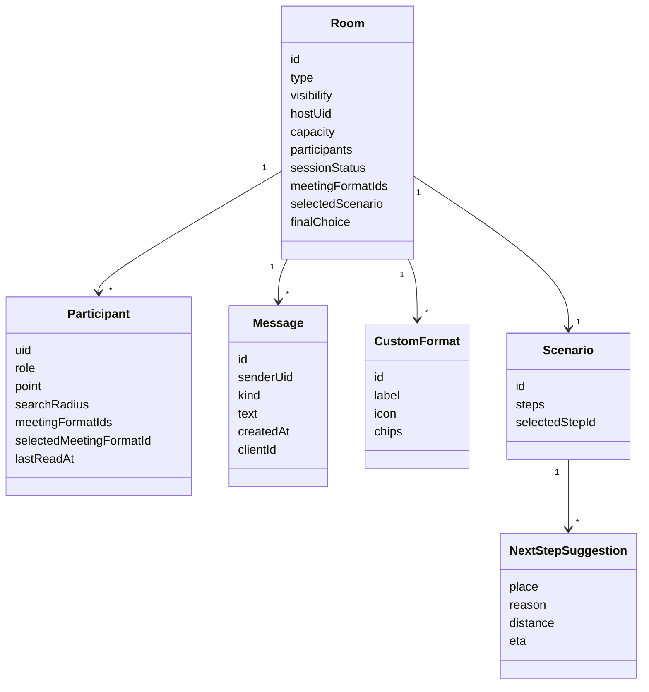
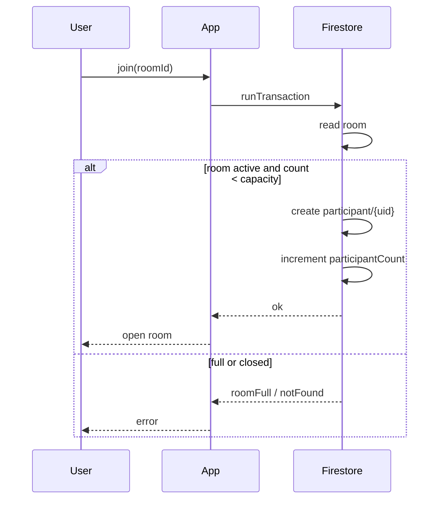
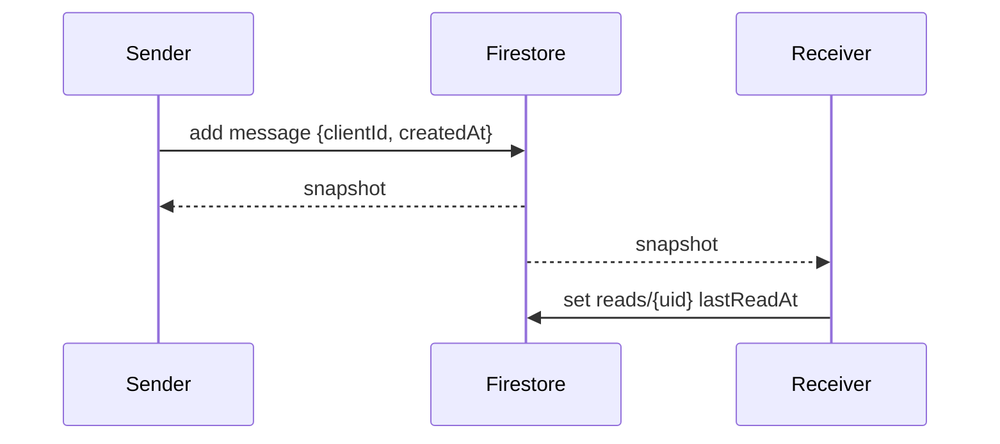
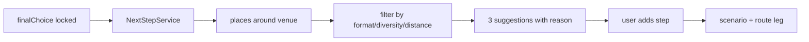
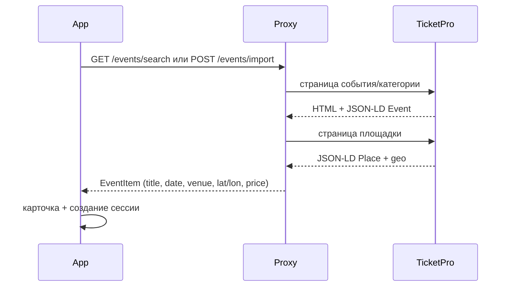
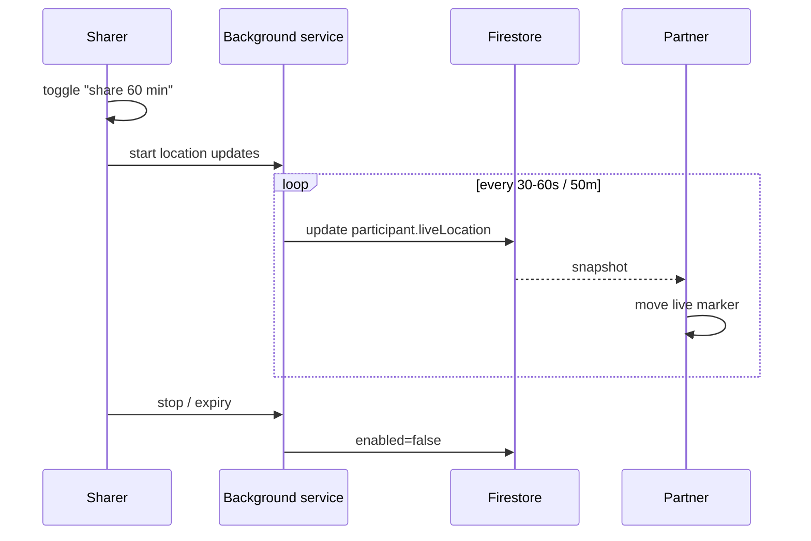
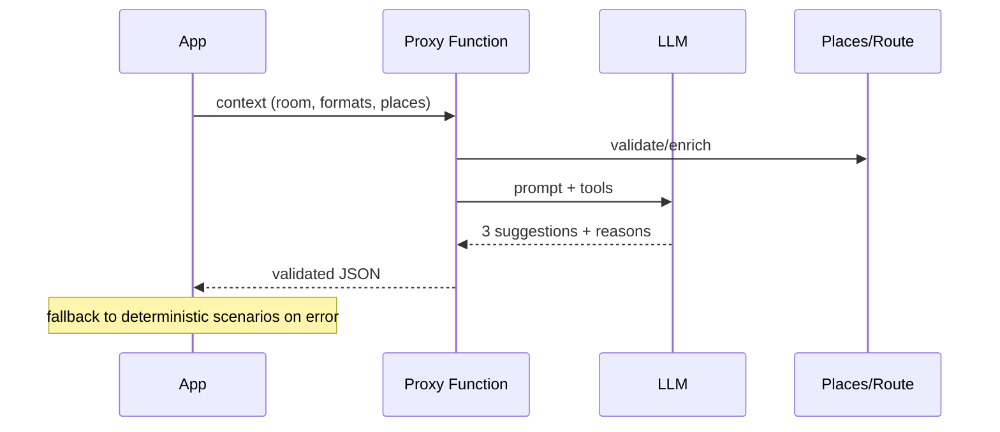

# Проектирование

## 1. Архитектура приложения
Feature-first + слои:
```text
presentation -> application -> domain <- data
```
- `presentation` — экраны, виджеты, контроллеры, состояние UI.
- `application` — сценарии, политики, переходы, синхронизация.
- `domain` — сущности, value objects, контракты, usecases.
- `data` — Firestore/HTTP, мапперы, кэш, реализации репозиториев.

Обоснование: проект уже развивается в этой структуре; она позволяет менять
источник данных и тестировать правила без UI. Подробнее — `docs/date_navigation_architecture.md`.

## 2. Доменная модель (целевая)


## 3. Схема Firestore v2
Полная схема и правила совместимости — `adr/0002-room-schema-v2.md` и
`~/.config/opencode/skills/date-navigation-app/references/firestore-model.md`.

Ключевые решения:
- `rooms/{id}` — метаданные и согласованное состояние.
- `rooms/{id}/participants/{uid}` — личные поля (точка, liveLocation, радиус,
  форматы, read). `point` — снимок для планирования, `liveLocation` — текущая
  позиция на время sharing.
- `rooms/{id}/messages/{id}` — чат.
- `rooms/{id}/reads/{uid}` — unread.
- `rooms/{id}/customFormats/{id}` — снимок формата для воспроизводимости.
- `rooms/{id}` — `event` (снимок события TicketPro/ручного).
- `users/{uid}/devices/{token}` — push-токены.

Почему подколлекции: разные права записи на пользователя, меньше конфликтов
за документ, проще rules. Цена — больше чтений; для N участников это приемлемо.

## 4. Сценарии

### 4.1. Вступление в открытую сессию


### 4.2. Сообщение

Optimistic UI: локальное сообщение с `clientId`; при snapshot заменяется/дедуплицируется.

### 4.3. «Куда дальше»


### 4.4. События TicketPro

- `EventSource` в domain; `TicketProEventSource` в proxy.
- В комнате хранится снимок события (`event`), чтобы сессия была воспроизводима.
- Fallback: ручная карточка, если JSON-LD не распознан.
- Атрибуция «Данные: TicketPro» и ссылка на событие.

### 4.5. Live-геолокация (stretch)

- `point` и `liveLocation` — разные поля и маркеры.
- Центр встречи не пересчитывается автоматически.
- Авто-стоп: час, финальное место, выход.
- Только приватные комнаты.

### 4.6. AI-консьерж


## 5. Безопасность
- Rules: доступ к комнате — участник; публичное чтение — только метаданные открытой сессии.
- Личные точки — в participant-документах; в списке открытых не отдаются.
- Чат: sender == auth.uid, text 1..2000, kind allowlist, update/delete запрещены.
- События: импорт только с домена ticketpro.by; данные — снимок, не доверять
  произвольному URL; кэш и rate limit на прокси.
- Live-локация: писать можно только свой `liveLocation`; `expiresAt` проверяется;
  в открытых комнатах запрещено; история не хранится.
- Кастомные форматы: валидация id/label/chips; селекторы — из allowlist, не произвольный Overpass QL.
- AI: ключ на сервере; контекст без лишних персональных данных; rate limit.
- Push: токены только владельцу; отправка — сервер.

## 6. Состояния комнаты
```text
active -> completed (host)
active -> expired (TTL/cleanup)
active -> left (participant leaves; private -> completed?)
```
Открытая сессия: после выхода хоста — либо назначение нового хоста, либо завершение.
Решение фиксируется в ADR (TODO).

## 7. UI/UX структура (целевая)
- Bottom navigation: Карта / Сессии / События / Чаты / Профиль.
- Комната: вкладки «Места», «Событие», «Чат», «Маршрут», «Настройки».
- Карта: два маркера — точка планирования и live-позиция напарника.
- Панель комнаты: адрес/моя точка, формат, места, «Куда дальше», AI-консьерж.
- Состояния: loading/empty/error/success; skeleton для списков.
- Motion: единые durations/easings, Hero для карточек, анимация камеры, переходы вкладок.

## 8. Тестируемость
- Domain: чистые функции/политики — unit.
- Application: сценарии с fake-репозиториями.
- Data: мапперы, кэш, HTTP-клиенты с mock.
- Rules: contract/emulator.
- UI: widget-тесты ключевых состояний.
- E2E/ручной smoke: 2–3 устройства.

## 9. Открытые вопросы
- Кто может завершить открытую сессию и что с точками после выхода.
- Нужен ли approval при вступлении.
- Гео-фильтр: geohash сейчас или city/country + клиентская сортировка.
- Хранение кастомных форматов: снимок в комнате или ссылка на библиотеку.
- Модерация чата: минимальная или вне границ.

## 9. Открытая сессия: эталон поведения

Эталон согласован с автором проекта 2026-11-05. Открытая сессия — отдельная
логика от приватной комнаты (2 участника, роли «создатель/партнёр», совместный
выбор места). Общие только карта, точки, чат и транзакции Firestore.

### 9.1. Решения
1. Вход: из списка и по коду приглашения.
2. Интерес: событие (TicketPro) и описание, которое пишет хост.
3. Место: хост предлагает место или план; любой участник может предложить
   следующее место; выбирает хост. Радиус поиска по умолчанию 1 км, хост может изменить.
4. Вместимость: от 2 до 10 участников.
5. Выход участника не завершает сессию.
6. Выход хоста: хост передаётся участнику, вошедшему раньше других (сессия продолжается).
7. Завершить сессию может только хост.
8. Точки участников видны всем участникам сессии; в списке сессий адресов нет.
9. Чат: только участникам, только в активной сессии; до входа недоступен.
10. План (событие и следующее место) виден до входа в сессию.
11. Центр встречи для N участников не используется (ADR-0004). Открытая сессия
    не пересчитывает центр автоматически.

### 9.2. Сценарии (use cases)
Фаза 1 — ядро открытой сессии (делаем первой):

| ID | Сценарий | Результат | Граничные случаи |
|---|---|---|---|
| UC-01 | Хост создаёт сессию: вместимость 2–10, событие (опционально), описание | Сессия в списке, хост внутри как участник | нет событий в выдаче — сессия без события; вместимость вне диапазона — отказ |
| UC-02 | Список открытых сессий | Карточки: событие/«Без события», описание, занято/вместимость | закрытые, заполненные, истёкшие скрыты; пустой список — текст и кнопка «Создать» |
| UC-03 | Обновление списка (кнопка и pull-to-refresh) | Актуальные счётчики | при ошибке сети — сообщение, список не очищается |
| UC-04 | Вход из списка | Открывается экран сессии, участник добавлен | мест нет — отказ с сообщением; сессия закрыта — кнопка неактивна |
| UC-05 | Вход по коду приглашения | То же, что UC-04 | неверный код — сообщение; код закрытой сессии — отказ |
| UC-06 | Список участников на экране сессии | Имя, фото (из Google), статус: адрес введён / нет, хост помечен | участник без фото — инициал |
| UC-07 | Ввод своего адреса | Точка записана в участника, видна всем участникам | адрес не найден — сообщение, экран остаётся; сеть — повтор |
| UC-08 | Точки на карте | Своя точка — отдельный маркер; точки участников — другой цвет; по нажатию — карточка участника | точек нет — карта без маркеров |
| UC-09 | Кнопка «Ввести адрес» | Видна, пока своей точки нет; после ввода скрывается | баннера «Введите адрес» на экране сессии нет |
| UC-10 | Чат | Сообщения участникам; непрочитанные по участнику; «прочитано» — кем | до входа чата нет; в завершённой сессии — только чтение |
| UC-11 | Выход участника | Участник удаляется из списка, место освобождается, остальные видят | хост выходит — см. UC-12 |
| UC-12 | Выход хоста | Хостом становится участник, вошедший раньше других | он единственный — сессия истекает или завершается по UC-13 |
| UC-13 | Завершение сессии (только хост) | Статус «завершена», чат только для чтения, вход закрыт | только хост; подтверждение действия |
| UC-14 | Истечение по времени | Как UC-13 без участия хоста | без зависших состояний |

Фаза 2 — план после события (делаем после фазы 1):

| ID | Сценарий | Результат |
|---|---|---|
| UC-15 | Хост предлагает следующее место (поиск рядом с событием, радиус 1 км по умолчанию) | Место добавлено в план |
| UC-16 | Участник предлагает следующее место | Предложение видно хосту и участникам, без автоматического принятия |
| UC-17 | Хост выбирает предложенное место | Место становится шагом плана |
| UC-18 | Маршрут от события до следующего места | Маршрут на карте внутри сессии |

### 9.3. Раскладка экранов
- **Список открытых сессий:** кнопка «Создать» (внизу справа), кнопка обновления в шапке,
  pull-to-refresh, поле ввода кода приглашения.
- **Карточка сессии в списке:** название события (или «Без события»), описание (до 2 строк),
  занято/вместимость, кнопка «Войти» (или «Заполнено» / «Закрыто»).
- **Экран сессии:** карта сверху; нижняя панель с вкладками «Участники | План | Чат».
  - Кнопка «Ввести адрес» — основная, пока своей точки нет.
  - В меню: «Поделиться кодом», «Выйти»; для хоста дополнительно «Завершить сессию».
  - Баннер «Введите свой адрес» не используется.

### 9.4. Что не входит в эталон
Рекомендации людей, модерация (kick/ban), платежи, live-геолокация (ADR-0006),
выбор места голосованием участников (R4).
