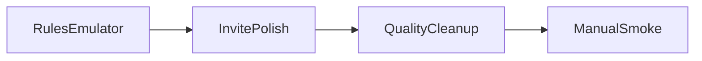

# Следующий спринт (завтра)

**Фокус:** довести хвосты квартального roadmap до «честно готово», не начинать новый большой epic.  
**Объём:** одна рабочая сессия (~3–5 пунктов).  
**Принцип:** только проверяемые улучшения UX/надёжности; без Cloud Functions / push / AI assistant.

---

## 1. Firestore rules emulator tests (главный хвост)

Сейчас есть только contract-тесты текста rules (`test/firestore_rules_contract_test.dart`).  
Добавить реальные emulator tests (минимум):

- join вторым участником — ok
- creator overwrite `point2` / partner formats — deny
- partner overwrite `point1` / creator formats — deny
- invite create без `createdBy` / `expiresAt` — deny
- history create для participant — ok

Стек: `@firebase/rules-unit-testing` в `scripts/` + job в `.github/workflows/ci.yml`.

**DoD:** CI падает, если rules снова станут слишком дырявыми.

---

## 2. Invite polish

- Share invite уже есть; проверить cold/warm start на iOS + Android simulator
- Понятный dialog при invalid/expired invite (не только banner) — `ConfirmDialog.showInfo` с `inviteInvalidTitle` / `inviteInvalidMessage`
- Copy code one-tap рядом с Share (удобнее для демо без deep link host)
- Документировать ограничение: `https://datenavigation.app/...` требует hosting/Universal Links; для демо опираемся на `datenavigation://join/{code}`

**DoD:** join по custom scheme и по коду стабильно на 2 симуляторах.

---

## 3. Small quality cleanup

- Убрать emoji из data-layer логов (`GeocodingRemoteDataSource`, `PlacesRemoteDataSource`, `MeetingRepositoryImpl`) — нейтральный `AppLogger` текст
- Проверить, что `config/dart_defines.json` и `ios/build/` реально не попадают в commit (уже в `.gitignore`)
- При необходимости: `dart format` только на грязных файлах из завтрашнего diff

**DoD:** нет secrets/build artifacts в staging; логи без emoji-шума.

---

## 4. Manual smoke (закрытие дня)

Пройти `docs/core_loop_smoke_checklist.md` на 2 устройствах:

- create → share/join → addresses → format → places
- logout / locale / partner leave
- OSRM degraded path
- empty places → «увеличить радиус» реально расширяет slider

---

## Out of scope на завтра

- Cloud Functions places proxy
- Push notifications
- 3+ participants / multi-city backend
- Store publish
- Большой AI date assistant
- Полный Universal Links hosting setup (только документируем gap)

---

## Порядок работ завтра

1. Rules emulator suite + CI job  
2. Invite invalid dialog + copy code  
3. Log cleanup / ignore sanity  
4. Manual smoke checklist  

Если останется время: widget/provider test на `expandSearchRadiusAndRetry` и deep-link parse → pending code consume.
